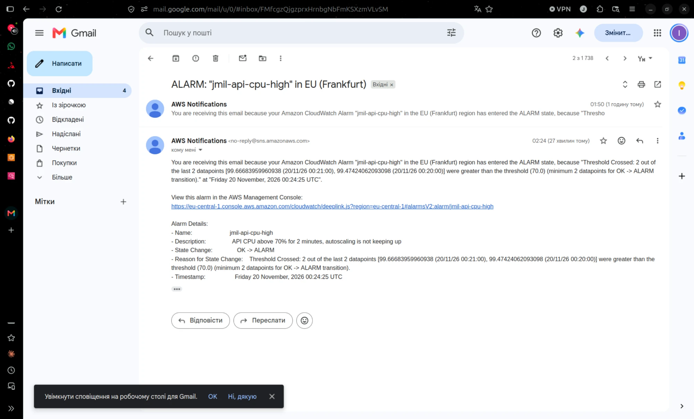
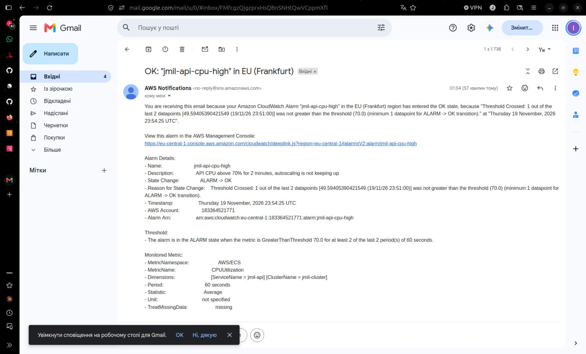

# Сповіщення на пошту

Завдання 4. Код: [`infra/monitoring.tf`](../infra/monitoring.tf), ресурси `aws_cloudwatch_metric_alarm.api_cpu_high`, `aws_sns_topic.alerts`, `aws_sns_topic_subscription.email`.

## Коли приходить лист

Коли середнє завантаження процесора API тримається **вище 70 % дві хвилини поспіль**, приходить перший лист («тривога», ALARM). Коли все повертається в норму — другий («все гаразд», OK).

| Що                        | Як                                                         |
| ------------------------- | ---------------------------------------------------------- |
| За чим стежимо            | процесор сервісу `jmil-api` (`CPUUtilization` з `AWS/ECS`) |
| Як рахуємо                | середнє за кожну хвилину                                   |
| Коли тривога              | обидві останні хвилини вище 70 %                           |
| Куди                      | пошта, через AWS SNS (`jmil-alerts`)                       |
| Що треба зробити один раз | підтвердити підписку за посиланням з першого листа від AWS |

### Чому саме так

- **70 %, а не 60 %.** Автомасштабування тримає процесор біля 60 %. Поки воно справляється, лист не потрібен. Якщо процесор довго вище 70 %, щось пішло не так: нові копії ще не запустились, уже працює максимум (4 копії) або копії взагалі не стартують. Про це має знати людина.
- **Дві хвилини, а не одразу.** Одна хвилина з високим процесором буває і в нормі, наприклад після оновлення. Якщо слати лист на кожен такий сплеск, пошту засипле.
- **Процесор, а не швидкість відповіді.** Для користувача важливіша швидкість. Але процесор росте раніше, ніж сайт помітно сповільнюється, і одразу підказує, де шукати проблему. На помилки 5xx є окреме сповіщення ще з першої лаби.

## Як це спрацювало під час тестів

Підписку підтверджено. За час тестів AWS доставив 8 листів і жодного не втратив. Час — за Києвом.

| Запуск          | Процесор > 70 % з | Лист «тривога» | Лист «все гаразд» | Скільки тривало |
| --------------- | ----------------- | -------------- | ----------------- | --------------- |
| `lab2-baseline` | 01:46             | 01:50:25       | 01:54:25          | 4 хв            |
| `lab2-async`    | 02:20             | 02:24:25       | 02:28:25          | 4 хв            |
| `stress-80`     | 02:49             | 02:53:25       | 02:57:25          | 4 хв            |
| `stress-80`     | —                 | 02:59:25       | 03:00:25          | 1 хв            |

Ось як листи виглядають у пошті:

_Лист «тривога» під час `lab2-async`: 00:24:25 UTC (02:24 за Києвом). У листі видно причину: дві хвилини поспіль процесор був вище 70 % — 99.47 % о 00:20 і 99.67 % о 00:21 UTC. Вище в списку — такий самий лист о 01:50 від `lab2-baseline`._

_Лист «все гаразд» після `lab2-baseline`: 23:54:25 UTC (01:54 за Києвом). Для тривоги потрібно, щоб обидві останні хвилини були вище 70 %. Одна з них була 49.59 % (23:51 UTC), тому тривогу знято._

Що з цього видно:

- **Лист приходить приблизно через 4 хвилини** після того, як процесор перевищив 70 %: дві хвилини очікування, плюс ~1 хв, поки дані потрапляють в AWS, плюс ~1 хв, поки їх перевіряють.
- **Лист приходив саме тоді, коли треба:** одна копія API завантажена на 100 %, а автомасштабування ще не встигло. Лист приходив за 1–2 хвилини до того, як запускалась друга копія.
- **«Все гаразд» приходило,** коли нові копії починали працювати або коли навантаження спадало.
- **Після `stress-80` був зайвий лист:** о 02:59 знову «тривога», а через хвилину «все гаразд». Це кінець тесту: дві копії ще 2 хвилини були завантажені вище 70 %. Якщо такі листи заважатимуть, можна чекати 3 хвилини замість 2.
