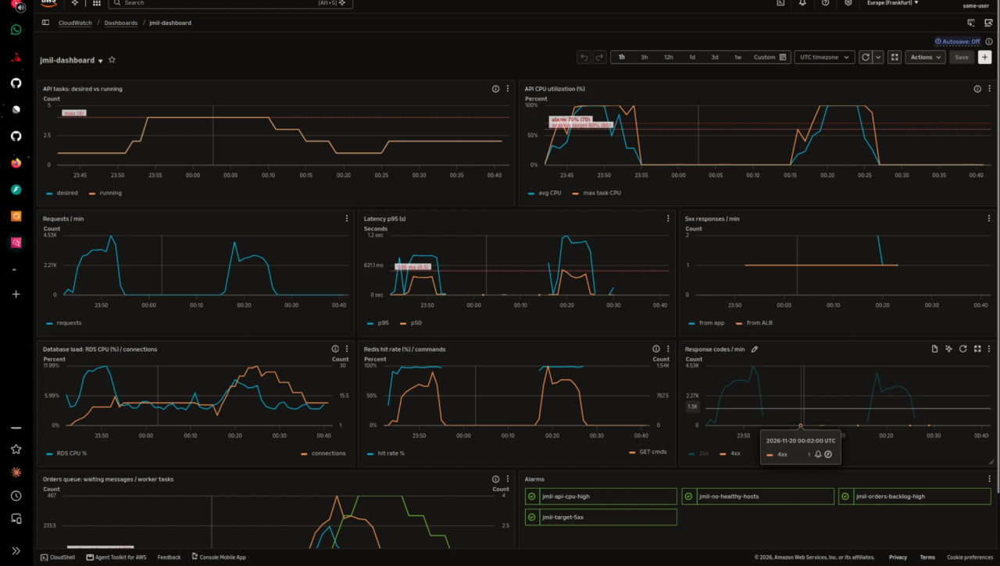

# Автомасштабування і дашборд

Завдання 1 і 3. Код: [`infra/autoscaling.tf`](../infra/autoscaling.tf), [`infra/monitoring.tf`](../infra/monitoring.tf).

## Як це працює

API працює в AWS у кількох однакових копіях. В ECS кожна така копія називається **задачею** (task). Одна копія отримує чверть ядра процесора (0.25 vCPU) і 512 МБ пам'яті.

Коли навантаження росте, AWS сам додає копії. Коли спадає — прибирає. Правило таке: **середнє завантаження процесора має бути близько 60 %**.

| Налаштування             | Значення                                                         |
| ------------------------ | ---------------------------------------------------------------- |
| Тип правила              | Target tracking («тримай ціль»)                                  |
| За чим стежимо           | `ECSServiceAverageCPUUtilization` — середній процесор усіх копій |
| Ціль                     | 60 %                                                             |
| Мінімум / максимум копій | 1 / 4                                                            |
| Пауза після додавання    | 60 с                                                             |
| Пауза після вилучення    | 180 с                                                            |

Більше 4 копій поставити не можна: так обмежує змінна `api_max_count`.

Під капотом AWS створює два аларми:

- **AlarmHigh** — процесор вище 60 % три хвилини поспіль. Тоді копії додаються. Скільки саме, AWS рахує так: `зараз копій × поточний процесор / 60`, з округленням угору.
- **AlarmLow** — процесор нижче 54 % п'ятнадцять хвилин поспіль. Тоді копії прибираються.

### Чому саме 60 %

- Нова копія запускається 1–2 хвилини. Поки вона стартує, старі мають впоратися самі. На 60 % у них ще є близько 40 % запасу.
- Коли процесор на 100 %, запити стають у чергу і сайт помітно сповільнюється. На 60 % цього ще немає.
- Якщо поставити 30–40 %, ми платили б за копії, які здебільшого нічого не роблять.
- Лист-попередження приходить на 70 %. Масштабування на 60 % має спрацювати раніше, а лист — лише тоді, коли воно не встигло.

Можна було б рахувати не процесор, а кількість запитів на копію. Це краще, коли сервіс здебільшого чекає на базу. Наш API сам перетворює дані в JSON на слабкому процесорі, тому першим закінчується саме процесор.

### Навіщо паузи після кроку

Після кожного кроку AWS трохи чекає, перш ніж зробити ще один у той самий бік. Нова копія ще стартує, і її ефект поки не видно.

- **Після додавання — 60 с.** Якщо за хвилину процесор не впав, можна додати ще. Пауза коротка, бо нестача копій одразу шкодить користувачам.
- **Після вилучення — 180 с.** Довше, бо якщо прибрати копію зарано, перевантаження повернеться.

Що було б без пауз:

1. **Забагато копій.** Процесор ще високий, бо нова копія тільки стартує. AWS вирішить, що треба ще, і може дійти до максимуму, хоча вистачило б двох.
2. **Розгойдування.** Прибрали копію — на інших зросло навантаження — копію додали знову. Кожен такий цикл — це новий контейнер, зайві гроші і ризик обірваних запитів.

Частково від цього рятують самі аларми (вони чекають 3 і 15 хвилин), але тоді запасу на старт копії вже немає.

## Дашборд

Дашборд називається `jmil-dashboard`. Посилання на нього: `terraform -chdir=infra output dashboard_url`. Усі графіки оновлюються щохвилини.

| #   | Графік            | Що показує                                                              |
| --- | ----------------- | ----------------------------------------------------------------------- |
| 1   | Кількість копій   | скільки копій потрібно (`desired`) і скільки реально працює (`running`) |
| 2   | Процесор          | середній і максимальний по копіях, з лініями 60 % і 70 %                |
| 3   | Запити за хвилину | скільки запитів прийшло на балансувальник                               |
| 4   | Час відповіді     | p95 і p50, з лінією 500 мс                                              |
| 5   | Помилки 5xx       | окремо від застосунку і від самого балансувальника                      |

Крім цього, на дашборді є: процесор і з'єднання бази, частка відповідей з кешу Redis, коди відповідей, черга з воркерами і стан алармів.

Щоб AWS показував кількість копій, на кластері увімкнено Container Insights. Без нього цього графіка немає.

## Що показав дашборд під навантаженням

Дані з запусків `lab2-baseline`, `lab2-async` і `stress-80` ([LOADTEST.md](LOADTEST.md)). Час — за Києвом.

_Дашборд за годину, 23:42–00:42 UTC (01:42–02:42 за Києвом). Видно два запуски: `lab2-baseline` о 23:44–23:55 UTC і `lab2-async` о 00:16–00:27 UTC._

Що тут видно:

- **Копії** (зліва вгорі). Під час першого тесту їх стає 1 → 2 → 4, потім вони сходинками зменшуються 4 → 3 → 2 → 1 (00:10–00:18 UTC). Під час другого тесту знову 1 → 2. Синя лінія («потрібно») щоразу на хвилину випереджає помаранчеву («працює»).
- **Процесор** (справа вгорі). Поки працює одна копія, максимум упирається в 100 %. Щойно запускається друга, середнє падає. Пунктири — ціль 60 % і поріг попередження 70 %.
- **Час відповіді.** Поки працює одна копія, p95 тримається на ~0.8 с у першому тесті і ~1.1 с у другому.
- **Помилки 5xx.** Одна точка від застосунку під час другого тесту — це ті самі `500` на перевірці статусу замовлення (див. [QUEUE.md](QUEUE.md)). І одна від балансувальника.
- **База** не завантажується більше ніж на 12 %. **Redis** віддає майже 100 % відповідей з кешу.
- **Черга.** На початку другого тесту замовлень накопичується багато, і воркерів стає 4.
- **Аларми** на момент знімка всі зелені (OK).

### Як додавались копії

| Запуск          | Процесор > 60 % | Рішення додати | Друга копія працює | Що далі                        |
| --------------- | --------------- | -------------- | ------------------ | ------------------------------ |
| `lab2-baseline` | 01:46           | 01:51:28 → 2   | 01:52              | 01:53:28 → 4, працюють з 01:54 |
| `lab2-async`    | 02:20           | 02:25:28 → 2   | 02:26              | —                              |
| `stress-80`     | 02:48           | 02:54:28 → 2   | 02:55              | 03:00:28 → 3, вже після тесту  |

- **Друга копія з'являється через 6–7 хвилин**, а не через 4–5, як виходить за розрахунком нижче. Ще ~1 хв іде, поки дані про процесор з'являться в CloudWatch, і ~1 хв — на запуск самої копії.
- **Наступний крок — уже через 2 хвилини.** У першому тесті копій стало одразу 4, а не 3: обидві копії були завантажені майже на 100 %, і формула дала `2 × 100 / 60 ≈ 4`.
- **Масштабування не встигало.** Пік у тесті триває 5 хвилин, тож потрібна кількість копій набиралась, коли навантаження вже спадало. Поки працювала одна копія, процесор був на 100 %, а p95 — 0.8–1.1 с.
- **Коли копій вистачало, p95 падав до 30 мс.**
- **Після `stress-80` додалась зайва копія.** Тест закінчився о 02:58, а третя копія з'явилась о 03:00: аларм спрацював на старих даних.

### Як прибирались копії

Після `lab2-baseline` (тест закінчився о 01:54, працювало 4 копії):

| Час   | Що сталося  |
| ----- | ----------- |
| 02:10 | 4 → 3 копії |
| 02:14 | 3 → 2       |
| 02:18 | 2 → 1       |

Перша копія прибирається через 16 хвилин після кінця навантаження, далі по одній кожні 4 хвилини. До однієї копії сервіс повернувся за 24 хвилини. Після `stress-80` так само: 03:22 → 2, 03:26 → 1.

Користувачі цього не помічають: за всі тести не було жодної помилки від застосунку через вилучення копій. Єдині 4 помилки `500` у `lab2-async` мають іншу причину.

### Що можна покращити

- **Мати запас ще до піку.** Вдень тримати мінімум 2 копії ([SCHEDULE.md](SCHEDULE.md)) або давати кожній копії пів ядра. Тоді одна копія не впирається в 100 %, поки AWS вирішує, що робити.
- **Реагувати швидше.** Зробити власний аларм, який спрацьовує після 1 хвилини, а не 3. Це на 2 хвилини швидше, але масштабування частіше реагуватиме на короткі сплески.

## Чому нова копія з'являється не одразу

Від моменту, коли процесор перевищив поріг, до моменту, коли нова копія відповідає на запити, проходить кілька кроків:

| Крок                                                       | Скільки |
| ---------------------------------------------------------- | ------- |
| Дані про процесор потрапляють у CloudWatch                 | ~1 хв   |
| Аларм чекає три хвилини поспіль                            | 3 хв    |
| AWS вирішує додати копію і запускає її                     | секунди |
| Fargate виділяє ресурси і завантажує образ                 | 30–60 с |
| Міграції бази, старт сервера                               | 5–10 с  |
| Балансувальник двічі перевіряє, що копія жива (кожні 15 с) | ~30 с   |

За розрахунком виходить 4–5 хвилин, а в тестах вийшло 6–7. На графіку копій видно, що «потрібно» росте раніше, ніж «працює».

## Чому копії прибираються так повільно

- **Аларм чекає 15 хвилин** низького навантаження. Так AWS перевіряє, що навантаження справді спало, а не просто коротка пауза. Зайва копія коштує близько $0.014 на годину, а нестача копій — помилок у користувачів.
- **Між кроками пауза 180 с.**
- **Копія вимикається акуратно.** Спочатку балансувальник перестає слати їй нові запити і 30 с чекає, поки вона доробить поточні. Потім ECS просить процес завершитись (SIGTERM). Сервер доробляє запити, закриває з'єднання з базою і Redis і виходить. Якщо за 30 с не встиг — ECS вимикає його примусово.

Тому після навантаження сервіс повертається до однієї копії за 15–25 хвилин. Після `lab2-baseline` на це пішло 24 хвилини.
