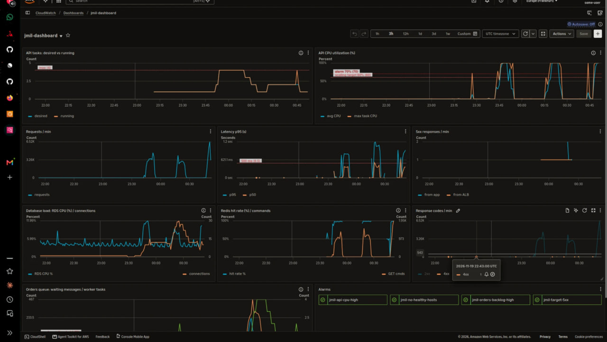

# Навантажувальне тестування

Завдання 2. Сценарій для k6: [`loadtest/script.js`](../loadtest/script.js). Запуск: [`loadtest/run.sh`](../loadtest/run.sh).

## Як запустити

```bash
./loadtest/run.sh lab2-baseline
```

Скрипт сам бере адресу сайту з `terraform output frontend_url`. Це адреса CloudFront. Якщо треба бити напряму в балансувальник (ALB), задайте адресу вручну:

```bash
BASE_URL=$(terraform -chdir=infra output -raw alb_url) ./loadtest/run.sh lab2-baseline
```

Якщо k6 не встановлено, скрипт запустить його в Docker (образ `grafana/k6:1.3.0`). Результати зберігаються в `loadtest/results/<назва>.txt`, `.json` і `.log`.

Що можна налаштувати:

| Змінна                             | За замовчуванням | Що це                                                                          |
| ---------------------------------- | ---------------- | ------------------------------------------------------------------------------ |
| `VUS`                              | 40               | скільки користувачів одночасно (N)                                             |
| `RAMP_UP` / `STEADY` / `RAMP_DOWN` | 3m / 5m / 2m     | скільки триває розгін, рівне навантаження і спад                               |
| `WRITE_MODE`                       | `sync`           | `sync` — замовлення через `POST /orders`, `async` — через `POST /orders/async` |
| `USERS`                            | 10               | скільки акаунтів створити для тесту                                            |
| `THINK`                            | 0.3              | пауза між запитами одного користувача, у секундах                              |
| `BASE_URL`                         | `frontend_url`   | адреса сайту                                                                   |

## Що робить тест

Спочатку тест реєструє кількох користувачів і входить під ними. Вхід навмисно повільний: пароль перевіряється алгоритмом Argon2, який довго рахує. Тому вхід робиться один раз на старті, а не в кожному циклі.

Далі кожен віртуальний користувач по колу робить 10 запитів: 1 замовлення і 9 переглядів.

| #   | Запит                  | Що робить | Що імітує                                    |
| --- | ---------------------- | --------- | -------------------------------------------- |
| 1   | `POST /orders`         | запис     | оформлення замовлення                        |
| 2   | `GET /products?…`      | читання   | сторінка каталогу                            |
| 3   | `GET /products/{id}`   | читання   | випадковий товар                             |
| 4   | `GET /orders/{id}`     | читання   | щойно створене замовлення                    |
| 5   | `GET /products/facets` | читання   | список фільтрів                              |
| 6   | `GET /products?…`      | читання   | інша сторінка каталогу                       |
| 7   | `GET /users/me`        | читання   | профіль користувача (замість «даних автора») |
| 8   | `GET /news`            | читання   | новини                                       |
| 9   | `GET /products/{id}`   | читання   | товар, який щойно замовили                   |
| 10  | `GET /products?…`      | читання   | ще одна сторінка каталогу                    |

Каталог відкривається так, як це зазвичай роблять люди: найчастіше перша сторінка, іноді сортування, категорія чи бренд. Між запитами пауза 0.3 с.

Тест іде в три етапи: 3 хвилини кількість користувачів росте від 0 до N, 5 хвилин тримається на N, 2 хвилини падає до 0.

Кожна відповідь перевіряється. Тест вважається проваленим, якщо:

- помилок більше 1 %;
- або p95 читань більше 2 с;
- або p95 записів більше 3 с.

**p95** означає: 95 % запитів отримали відповідь не довше за це число. Тобто це час, який бачить майже кожен користувач, крім 5 % найневдаліших запитів. **p50** — це середина: половина запитів швидша, половина повільніша.

## Пробний запуск

Перед справжнім тестом зроблено короткий пробний (smoke): 5 користувачів, 35 секунд, напряму в ALB. Мета — переконатися, що все працює.

```bash
VUS=5 RAMP_UP=10s STEADY=20s RAMP_DOWN=5s ./loadtest/run.sh smoke
```

| Що                | Результат            |
| ----------------- | -------------------- |
| Запитів           | 442 (8.3 за секунду) |
| Помилок           | 0 %                  |
| Читання p50 / p95 | 34 / 43 мс           |
| Записи p50 / p95  | 46 / 81 мс           |
| Відповідей з кешу | 90.5 %               |

Усе працює, помилок немає. Найповільніші запити (до 0.9 с) — це реєстрація і вхід на старті тесту. Один вхід займає близько 0.5 с, і підготовка 10 користувачів забирає 17 с. У цифри читань і записів вони не входять.

Під час пробного запуску процесор API був завантажений до 40 %, і то здебільшого через вхід. Для повного тесту взято 40 користувачів: цього вистачає, щоб одна копія API перевищила 60 % і спрацювало автомасштабування.

## Результати

Чотири запуски 19–20 листопада 2026 року. Час — за Києвом. Перед кожним повним запуском працювала одна копія API.

| Запуск          | Користувачів | Замовлення | Куди       | Запитів/с | Помилок | Читання p50 / p95 | Записи p50 / p95 | З кешу   |
| --------------- | ------------ | ---------- | ---------- | --------- | ------- | ----------------- | ---------------- | -------- |
| `smoke`         | 5            | sync       | ALB        | 8.3       | 0 %     | 34 / 43 мс        | 46 / 81 мс       | 90.5 %   |
| `lab2-baseline` | 40           | sync       | ALB        | 49.9      | 0 %     | 115 / 706 мс      | 500 / 1082 мс    | 97.4 %   |
| `lab2-async`    | 40           | async      | ALB        | 42.4      | 0.02 %  | 203 / 1073 мс     | 498 / 1295 мс    | 97.1 %   |
| `stress-80`     | 80           | sync       | CloudFront | 88.4      | 0.002 % | 296 / 899 мс      | 519 / 1197 мс    | 98.4 %\* |

\* k6 показав тут 0 %, але це неправда. CloudFront підміняє наш заголовок `X-Cache` своїм, і k6 не бачить, що відповідь прийшла з кешу. Справжні 98.4 % взято зі статистики самого Redis (ElastiCache).

Усі три повні запуски пройшли тест.



_Дашборд за 3 години, 21:50–00:50 UTC (23:50–02:50 за Києвом). Видно три хвилі навантаження: `lab2-baseline` (23:44 UTC), `lab2-async` (00:16 UTC) і початок `stress-80` (00:47 UTC). Між ними кількість копій API повертається до однієї, а процесор, запити і з'єднання з базою падають майже до нуля. Що означає кожен графік — у [AUTOSCALING.md](AUTOSCALING.md#що-показав-дашборд-під-навантаженням)._

### `lab2-baseline`: 40 користувачів

| Час   | Етап            | Процесор API | p95    | Копій API             |
| ----- | --------------- | ------------ | ------ | --------------------- |
| 01:45 | розгін          | 39 %         | 20 мс  | 1                     |
| 01:46 | розгін          | 86 %         | 638 мс | 1                     |
| 01:47 | 40 користувачів | 99 %         | 828 мс | 1                     |
| 01:48 | 40 користувачів | 100 %        | 819 мс | 1                     |
| 01:49 | 40 користувачів | 100 %        | 818 мс | 1                     |
| 01:50 | 40 користувачів | 99 %         | 816 мс | 1                     |
| 01:51 | 40 користувачів | 50 %         | 821 мс | вирішено додати 2-гу  |
| 01:52 | спад            | 84 %         | 779 мс | 2                     |
| 01:53 | спад            | 28 %         | 31 мс  | вирішено довести до 4 |
| 01:54 | кінець          | —            | —      | 4                     |

Що з цього видно:

- **Слабке місце — процесор API.** Одна копія API (чверть ядра) завантажується на 100 % приблизно на 30 користувачах.
- **Помилок немає.** Коли процесор зайнятий, запити просто чекають своєї черги. Через це відповідь сповільнюється до ~0.8 с, але не ламається.
- **База і Redis майже відпочивають.** Процесор бази не вище 12 %, Redis — менше 1 %.
- **Замовлення в 4 рази повільніші за перегляди** (500 мс проти 115 мс). Перегляди каталогу беруться з кешу, а кожне замовлення пишеться в базу.
- **Автомасштабування спрацювало, але пізно.** Від моменту, коли процесор перевищив 60 % (01:46), до появи другої копії (01:52) минуло 6 хвилин. Чотири копії запрацювали, коли тест уже закінчувався. Детальніше — у [AUTOSCALING.md](AUTOSCALING.md).

### `lab2-async`: ті самі 40 користувачів, але замовлення через чергу

Тут замовлення не пишеться в базу одразу. API кладе його в чергу, а окремий процес (воркер) потім створює його в базі.

Цей варіант вийшов **повільнішим**: 42 запити за секунду проти 50, а p95 переглядів — 1073 мс проти 706.

Чому так:

- Черга знімає роботу з бази. Але база й так не була завантажена.
- Слабке місце — процесор API. А для нього відправити замовлення в чергу не легше, ніж записати в базу. Треба записати статус у Redis і зробити запит до AWS SQS, а бібліотека boto3 кожен такий запит ще й підписує. Плюс клієнт окремо питає статус замовлення — це ще один запит до Redis.

Під час цього запуску з'явились помилки: 5 з 26 322 запитів.

- 4 з них — `500` на перевірці статусу замовлення (`GET /orders/requests/{id}`). Процесор API був завантажений на 100 % і не встиг дочекатися відповіді Redis за відведені 0.5 с. Кеш каталогу в такій ситуації просто йде в базу, а перевірка статусу так не вміла і падала.
- 1 — помилка від самого балансувальника.

Після тесту це виправлено: якщо Redis не відповідає, API тепер повертає `503` («спробуйте ще раз») з підказкою `Retry-After: 1`, а не `500`.

Воркери впоралися: всі 2630 замовлень з черги оброблені, жодне не загубилось. Деталі — у [QUEUE.md](QUEUE.md).

Висновок: черга корисна, коли повільна база або сторонній сервіс. Коли не вистачає процесора самого API, вона не допомагає.

### `stress-80`: 80 користувачів

| Час   | Процесор API | p95     | Копій API            |
| ----- | ------------ | ------- | -------------------- |
| 02:48 | 57 %         | 43 мс   | 1                    |
| 02:49 | 91 %         | 679 мс  | 1                    |
| 02:50 | 100 %        | 848 мс  | 1                    |
| 02:51 | 100 %        | 894 мс  | 1                    |
| 02:52 | 100 %        | 953 мс  | 1                    |
| 02:53 | 100 %        | 1035 мс | 1                    |
| 02:54 | 50 %         | 949 мс  | вирішено додати 2-гу |
| 02:55 | 87 %         | 1097 мс | 2                    |
| 02:56 | 81 %         | 980 мс  | 2                    |
| 02:57 | —            | 119 мс  | 2                    |

- **Удвічі більше користувачів — майже вдвічі більше запитів:** 50 → 88 за секунду. При цьому p95 зріс помірно, з 0.7 до 0.9 с. Між запитами користувачі роблять паузу, тому зайнятий процесор просто змушує запити трохи довше почекати.
- **Межу не знайдено.** На 80 користувачах лише 1 помилка з 54 651 запиту. Це одне замовлення, яке не дійшло до API, тобто зв'язок обірвався десь на CloudFront або балансувальнику.
- **Redis знову не встигав відповідати** (о 02:49, 02:50 і 02:55), але тільки для кешу каталогу. Там це не помилка: запит просто йде в базу.
- **Масштабування знову запізнилось.** Друга копія з'явилась через 7 хвилин після старту, третя — вже після кінця тесту (03:00).
- Цей запуск ішов через CloudFront. Це ще одна ланка на шляху, тому час відповіді не зовсім можна порівнювати з `lab2-baseline`.

### Висновки

1. **Слабке місце — процесор API** (чверть ядра на копію), а не база і не Redis. Найпростіше рішення — давати кожній копії більше процесора (пів ядра).
2. **Автомасштабування реагує 6–7 хвилин**, а пік у тесті триває 5. Щоб воно встигало, треба або реагувати швидше, або вдень одразу тримати 2 копії ([SCHEDULE.md](SCHEDULE.md)).
3. **Кеш працює:** 97–98 % переглядів каталогу не доходять до бази.
4. **Черга для замовлень не прискорює**, поки бракує саме процесора API.
5. **Наступний крок — знайти межу:** запустити 150 користувачів (`VUS=150`), коли API повернеться до однієї копії.
